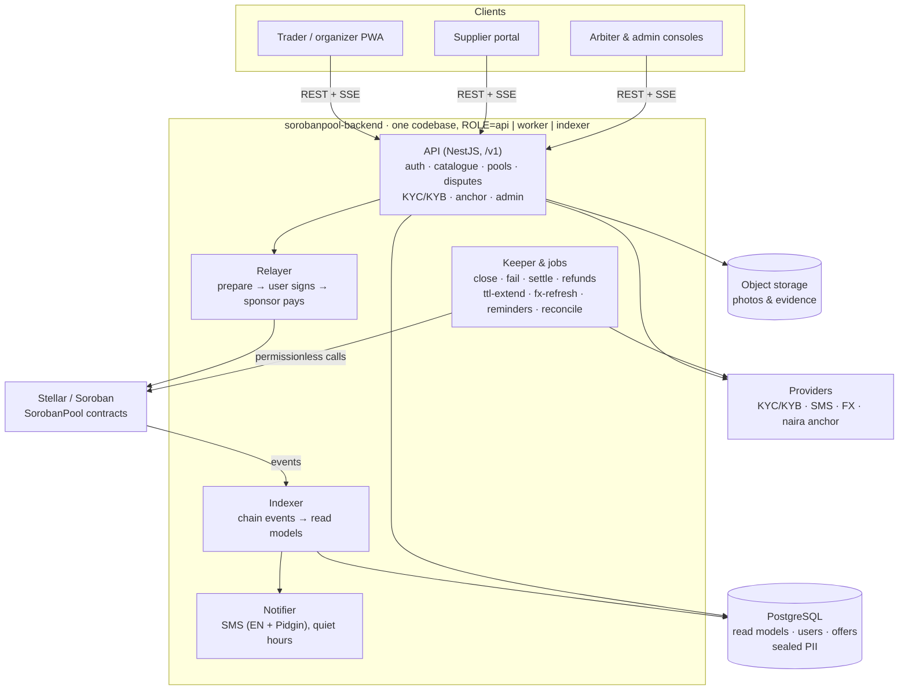
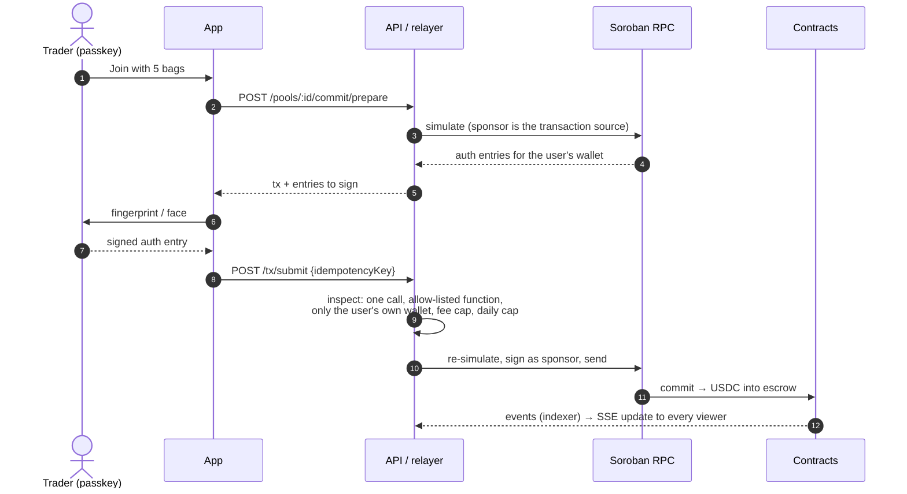
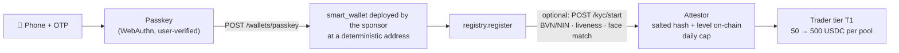

# sorobanpool-backend

**Buy together. Pay on delivery.** API, indexer, keeper and fee-sponsoring relayer for SorobanPool, a group-buying app for market traders in Nigeria. Built on Stellar.

[](https://github.com/SorobanPool/sorobanpool-backend/actions/workflows/ci.yml)


> Testnet only. The money rules live in the [contracts](https://github.com/SorobanPool/sorobanpool-contracts). This service **cannot move escrowed funds**: if it were fully compromised, the worst outcomes would be fake verifications, fake catalogue text and downtime, never theft.

Repos: [contracts](https://github.com/SorobanPool/sorobanpool-contracts) · **backend** (this one) · [frontend](https://github.com/SorobanPool/sorobanpool-frontend). The product and architecture brief: [docs/brief.md](https://github.com/SorobanPool/sorobanpool-contracts/blob/main/docs/brief.md).

---

## What this service does



| Role | What it runs | Notes |
|---|---|---|
| `ROLE=api` | REST under `/v1` ([docs/api.md](docs/api.md), [OpenAPI](docs/openapi.json)), live pool updates over SSE, Prometheus `/v1/metrics` | rate-limited per client; idempotency keys on submits |
| `ROLE=worker` | keeper (`close`, `fail_accept`, `fail_delivery`, shortfall allocation, `settle`, `push_refunds`, dispute timeouts), `ttl-extend`, `fx-refresh`, offer expiry, sponsor-balance alert, deadline reminders, reconcile, SMS notifier | every keeper action is permissionless on-chain, so a duplicate or late call is refused harmlessly |
| `ROLE=indexer` | polls Soroban RPC events into PostgreSQL, atomically and idempotently | read models can be rebuilt from stored raw events |

For a single process in development, `INDEXER_EMBEDDED=true` and `KEEPER_EMBEDDED=true` run everything inside the API.

## How a payment flows (and why users never need XLM)



The sponsor account pays every fee, but it can never act *as* a user. Source-account credentials, entries for anyone but the caller's wallet, multi-operation transactions and fees above 5 XLM are all refused ([ADR 0001](docs/decisions/0001-sponsor-as-transaction-source.md), `src/chain/inspect.ts`).

## Wallets, verification and money in naira



- **Passkey wallets** ([contracts ADR 0006](https://github.com/SorobanPool/sorobanpool-contracts/blob/main/docs/decisions/0006-passkey-smart-wallet.md)). The wallet is deployed from a passkey the user registered *here*, so the key was verified at registration (attestation, origin, RP ID). Deployment is idempotent. No seed phrase, no XLM.
- **KYC / KYB** ([ADR 0006](docs/decisions/0006-verification-provider-port.md)). Checks go through a provider port, with a sandbox today and Smile ID, Dojah or Prembly as the next adapter. Results are **sealed with AES-256-GCM**, and only `sha256(userId | providerRef | level | salt)` reaches the chain. Suppliers get automated CAC and bank-account-name checks, and an admin still decides.
- **FX**: two independent NGN/USD sources (`FX_SOURCES=er-api,coingecko`). Offer publishing is **blocked when they diverge by more than 2%**, and `fx-refresh` records the rate every minute.
- **Naira deposits**: an `AnchorProvider` port with a mock anchor until a licensed rail is chosen ([ADR 0005](docs/decisions/0005-naira-rails-mock-anchor.md)).

## Quickstart (about 5 minutes)

Needs Node 24, pnpm 10, Docker (or a local PostgreSQL 16+ and Redis 7) and the [Stellar CLI](https://developers.stellar.org/docs/tools/cli).

```bash
pnpm install
cp .env.example .env                          # loaded at startup; shell variables win
docker compose up -d postgres redis minio
stellar keys generate sp-dev --network testnet --fund
export SPONSOR_SECRET=$(stellar keys show sp-dev)   # pays testnet fees; never commit it
pnpm prisma:migrate:deploy
pnpm start:dev
curl localhost:3000/v1/health                 # {"status":"ok","role":"api"}
```

This runs against the contracts already on testnet (`deployments/testnet.json`, vendored by `scripts/sync-contract-artifacts.sh`). A fresh indexer starts at the deploy ledger, or inside the RPC retention window, and catches up ([runbook](docs/runbooks/indexer-backfill.md)).

**No database at all?** `SPONSOR_SECRET=S... pnpm dev:server` runs everything with an in-process PostgreSQL (PGlite) on port 3100. The frontend's E2E uses this.

## Testing

```bash
pnpm lint && pnpm exec tsc --noEmit && pnpm build
pnpm test                                     # 205 tests, real PostgreSQL semantics via PGlite
E2E_TESTNET=1 SPONSOR_SECRET=S... pnpm test:e2e   # live testnet (needs the deployment's admin key)
```

| Suite | What it proves |
|---|---|
| Unit and API (`src/**/*.spec.ts`) | relayer inspection and allow-list, auth and passkeys, catalogue validation, pricing parity with the contracts' 600 vectors, indexer projection and idempotency, keeper decisions, KYC/KYB and PII sealing, FX divergence, notifications |
| `test/e2e/m2-flow` | the whole lifecycle on testnet through the API: onboard, publish, pool, commits across price breaks, fill, accept, dispatch, shortfall delivery, settle, refunds |
| `test/e2e/passkey-wallet` | a trader with no classic account and no XLM: wallet deployed, funded, registered and committing money with passkey signatures only; a forged assertion is rejected on-chain |
| CI | lint, types, tests on PGlite **and** a real PostgreSQL 16 service, OpenAPI freshness, Docker build |

## Repository map

```text
src/
  app/            controllers (auth, catalog, pools, disputes, kyc, admin, anchor, tx, uploads, SSE, OpenAPI)
  chain/          Soroban RPC client, transaction inspection, TTL extension, contract artefacts
  relayer/        sponsorship allow-list and daily caps, fee bump
  indexer/        event decoding and projection into read models
  keeper/         which permissionless calls are due
  wallets/        passkey smart wallet helpers (COSE key, deterministic address)
  verification/   KYC/KYB provider port, sandbox, capped attestor
  fx/             quote combination and live sources
  anchor/         naira on/off-ramp port (mock)
  notifications/  SMS templates (EN + Pidgin), queue and dispatcher
  workers/        job runners and maintenance (reconcile, fx-refresh, reminders)
  common/ config/ observability/ persistence/ evidence/ sharecards/ risk/
prisma/           schema and migrations
docs/             API, OpenAPI, decisions (ADRs), runbooks
test/             harness, software WebAuthn authenticator, testnet E2E
```

## Operations

- **Health and metrics**: `GET /v1/health`, `GET /v1/metrics` (Prometheus; `METRICS_TOKEN` is required in production).
- **Errors**: `SENTRY_DSN` reports unexpected 500s and job crashes, without request bodies.
- **Alerts** (log lines today): indexer lag over 20 ledgers, reconcile mismatch, sponsor balance low, attestor at 80% of its daily cap, FX divergence.
- **Runbooks**: [docs/runbooks/](docs/runbooks/), covering TTL extension, notifications and maintenance, and indexer backfill.

## Contributing

Good first areas: SMS template wording (EN, Pidgin, and Hausa, Yoruba or Igbo next), share-card designs, record/replay fixtures for provider adapters, indexer projections, and runbooks. Auth, the relayer, the attestor, settlement and anything touching money need two maintainer reviews and a test that fails without the change. See [CONTRIBUTING.md](CONTRIBUTING.md) and [SECURITY.md](SECURITY.md).

## Status

| | |
|---|---|
| ✅ Done | API, relayer with fee sponsorship, indexer, keeper and maintenance jobs, passkey wallets, KYC/KYB flow (sandbox), live FX, SMS queue (console sender), mock naira anchor, admin/arbiter endpoints, SSE live updates, metrics, Sentry, S3 adapter |
| 🤝 Needs a partner or decision | licensed naira anchor and bank withdrawals, real KYC/KYB and SMS/WhatsApp providers, a paid FX feed, external audit and pilot |
| 🛠 Engineering left | BullMQ for multi-replica workers ([ADR 0002](docs/decisions/0002-interval-scheduler-instead-of-bullmq.md); run one worker replica today), OpenTelemetry, a pager integration, Redis fan-out for SSE and rate limits across replicas ([ADR 0007](docs/decisions/0007-server-sent-events-for-live-updates.md)) |

Licensed under Apache-2.0.
